# 🏥 ArogyaGrid (आरोग्य ग्रिड) — Full Stack System & Architectural Documentation

> **Official Enterprise Architecture & Software Engineering Specification**  
> **Domain**: National Health Mission (NHM) & Rajasthan Medical Services Corporation Limited (RMSCL), Government of Rajasthan  
> **Lead Architect & Developer**: Aditya Kumar Mishra (Enrollment No. Mur2401145)  
> **Repositories**:  
> • **Frontend Client**: `C:\Users\vadit\AndroidStudioProjects\ArogyaGrid`  
> • **Cloud Backend**: `C:\Users\vadit\OneDrive\Desktop\arogyagrid-backend`  
> • **Live Production API**: `https://arogyagrid-backend-aus8.onrender.com/api`  
> • **Cloud Database**: AWS Neon Serverless PostgreSQL (`ep-noisy-hall-b4y8orcn-pooler`)

---

## 📑 Table of Contents
1. [Executive Summary & Problem Statement](#1-executive-summary--problem-statement)
2. [Full-Stack Architecture & High-Level System Overview](#2-full-stack-architecture--high-level-system-overview)
3. [Architectural & Engineering Diagrams (Mermaid)](#3-architectural-diagrams-mermaid)
   - [3.1 High-Level Architecture & Infrastructure](#31-high-level-architecture--infrastructure)
     - [3.1.1 End-to-End System Architecture](#311-end-to-end-system-architecture)
     - [3.1.2 Cloud Infrastructure & Network Deployment Topology](#312-cloud-infrastructure--network-deployment-topology)
   - [3.2 Software Architectural Patterns & Component Layouts](#32-software-architectural-patterns--component-layouts)
     - [3.2.1 Frontend Jetpack Compose Clean Architecture (MVVM)](#321-frontend-jetpack-compose-clean-architecture-mvvm)
     - [3.2.2 Backend Spring Boot Layered Architecture](#322-backend-spring-boot-layered-architecture)
     - [3.2.3 Jetpack Compose UI Hierarchy & Screen Navigation Map](#323-jetpack-compose-ui-hierarchy--screen-navigation-map)
   - [3.3 Data Flow Diagrams (DFD)](#33-data-flow-diagrams-dfd)
     - [3.3.1 DFD Level 0 Context Diagram (System Context & External Entities)](#331-dfd-level-0-context-diagram)
     - [3.3.2 DFD Level 1 Functional Decomposition Diagram](#332-dfd-level-1-functional-decomposition-diagram)
   - [3.4 Domain Class & Object Diagrams](#34-domain-class--object-diagrams)
     - [3.4.1 Frontend Clean Architecture Domain & Data Class Diagram](#341-frontend-clean-architecture-domain--data-class-diagram)
     - [3.4.2 Backend JPA Entity & Repository Class Diagram](#342-backend-jpa-entity--repository-class-diagram)
   - [3.5 Database & Entity-Relationship Diagrams](#35-database--entity-relationship-diagrams)
     - [3.5.1 Full Database Entity-Relationship Diagram (ERD)](#351-full-database-entity-relationship-diagram-erd)
   - [3.6 Sequence Diagrams (Dynamic Interaction Scenarios)](#36-sequence-diagrams-dynamic-interaction-scenarios)
     - [3.6.1 Inter-Facility Emergency Redistribution & Transit Pass](#361-sequence-diagram-inter-facility-emergency-redistribution--transit-pass)
     - [3.6.2 IoT Cold-Chain Thermal Excursion Alerting & Van Dispatch](#362-sequence-diagram-iot-cold-chain-thermal-excursion-alerting)
     - [3.6.3 JWT Authentication & RBAC Authorization](#363-sequence-diagram-jwt-authentication--rbac-authorization)
     - [3.6.4 Offline-First Synchronization & WorkManager Replay Loop](#364-sequence-diagram-offline-first-synchronization--workmanager-replay-loop)
     - [3.6.5 Epidemic Surveillance & Syndromic Surge Alerting](#365-sequence-diagram-epidemic-surveillance--syndromic-surge-alerting)
   - [3.7 Process Flowcharts & Algorithmic Activity Diagrams](#37-process-flowcharts--algorithmic-activity-diagrams)
     - [3.7.1 Algorithmic Stockout Risk Evaluation & Surplus Pairing Engine](#371-algorithmic-stockout-risk-evaluation--surplus-pairing-engine)
     - [3.7.2 CameraX & ML Kit Barcode Scan-to-Stock Ledger Ingestion](#372-camerax--ml-kit-barcode-scan-to-stock-ledger-ingestion)
   - [3.8 State Machine Diagrams](#38-state-machine-diagrams)
     - [3.8.1 Redistribution Order Lifecycle State Machine](#381-state-machine-redistribution-order-lifecycle)
     - [3.8.2 Cold-Chain Unit Thermal State Machine](#382-cold-chain-unit-thermal-state-machine)
     - [3.8.3 User Session & Authentication Lifecycle State Machine](#383-user-session--authentication-lifecycle-state-machine)
4. [Backend Deep Dive (`arogyagrid-backend`)](#4-backend-deep-dive-arogyagrid-backend)
   - [4.1 Backend Technology Stack](#41-backend-technology-stack)
   - [4.2 Backend Directory Structure](#42-backend-directory-structure)
   - [4.3 Security & Role-Based Access Control (RBAC)](#43-security--role-based-access-control-rbac)
   - [4.4 REST API Specification & Endpoints](#44-rest-api-specification--endpoints)
   - [4.5 Core Mathematical & Algorithmic Engines](#45-core-mathematical--algorithmic-engines)
   - [4.6 Database Design & Data Seeding](#46-database-design--data-seeding)
5. [Frontend Deep Dive (`ArogyaGrid` Android Client)](#5-frontend-deep-dive-arogyagrid-android-client)
   - [5.1 Frontend Technology Stack](#51-frontend-technology-stack)
   - [5.2 Clean Architecture Package Breakdown](#52-clean-architecture-package-breakdown)
   - [5.3 Reactive State Management & ViewModels](#53-reactive-state-management--viewmodels)
   - [5.4 Offline-First Resiliency (Room + WorkManager + Fallback Interceptor)](#54-offline-first-resiliency-room--workmanager--fallback-interceptor)
   - [5.5 GIS Mapping & Green Corridor Navigation (Osmdroid)](#55-gis-mapping--green-corridor-navigation-osmdroid)
   - [5.6 Computer Vision & Barcode Scanning (CameraX + ML Kit)](#56-computer-vision--barcode-scanning-camerax--ml-kit)
   - [5.7 UI Screen Directory & Features](#57-ui-screen-directory--features)
   - [5.8 Bilingual Localization & WCAG AA Dark Theme Engine](#58-bilingual-localization--wcag-aa-dark-theme-engine)
6. [Cross-Cutting Concerns, DevOps & Deployment](#6-cross-cutting-concerns-devops--deployment)
7. [Verification, Quality Assurance & Test Matrix](#7-verification-quality-assurance--test-matrix)
8. [Setup, Build & Execution Guide](#8-setup-build--execution-guide)

---

## 1. Executive Summary & Problem Statement

### 1.1 Context
In public health networks across India (specifically modeled on Jaipur district, Rajasthan), healthcare delivery is structured in a pyramidal hierarchy:
1. **Apex Tertiary Hospitals**: Sawai ManSingh (SMS) Hospital, JK Lon Pediatric Hospital, RUHS College of Medical Sciences.
2. **Sub-District / Community Health Centres (CHCs)**: CHC Amber, CHC Chomu, CHC Sanganer.
3. **Primary Health Centres (PHCs) & Sub-Centres**: PHC Amer, PHC Jamwa Ramgarh, PHC Bassi.

### 1.2 Core Problem Statement
* **The Stockout vs. Surplus Paradox**: During localized disease outbreaks (e.g., acute diarrheal outbreaks or seasonal flu in Amer block), peripheral PHCs experience critical stockouts of essential items like Oral Rehydration Salts (ORS) or Amoxicillin within 24 to 48 hours. Simultaneously, tertiary hospitals less than 15 km away hold idle surplus stocks (3,000+ units) approaching expiry dates.
* **Manual Administrative Friction**: Conventional inter-facility medicine transfers require multi-layered paper requisition slips and administrative approvals that take 3 to 7 days, rendering them useless during acute epidemics.
* **Cold-Chain Biological Vulnerability**: Vaccines (Covaxin, Rotavirus, Polio) and insulin require continuous thermal maintenance ($2.0^\circ\text{C}$ to $8.0^\circ\text{C}$ or Sub-Zero $-25^\circ\text{C}$). Power disruptions in rural clinics compromise potency without real-time detection.
* **Lack of Predictive Decision Support**: Health administrators rely on historic monthly tallies rather than forward-looking ARIMA demand projections and syndromic surge indicators.

### 1.3 The ArogyaGrid Solution
**ArogyaGrid** is a distributed, full-stack predictive health logistics command center that:
1. Continuously evaluates days-of-coverage and computes algorithmic risk indexes across all Essential Drug List (EDL) lines.
2. Pairs deficit health centers with the nearest surplus facility using the Haversine geospatial formula.
3. Facilitates instantaneous Chief Medical & Health Officer (CMHO) one-tap digital approvals and generates official **Emergency Green Corridor Transit Gate Passes**.
4. Provides continuous IoT thermal telemetry tracking for cold-chain biologicals.
5. Operates seamlessly in offline rural environments through local Room database caching and background synchronization.

---

## 2. Full-Stack Architecture & High-Level System Overview

ArogyaGrid consists of four integrated tiers:

```
┌────────────────────────────────────────────────────────────────────────┐
│                   CLIENT TIER (Android Native Client)                  │
│   Kotlin 2.0 • Jetpack Compose • Material 3 • Clean Architecture       │
│   Room Local Cache • Osmdroid GIS • CameraX Barcode • WorkManager      │
└───────────────────────────────────┬────────────────────────────────────┘
                                    │ HTTPS / REST API / JSON
                                    ▼
┌────────────────────────────────────────────────────────────────────────┐
│                    API GATEWAY & SECURITY TIER                         │
│   Spring Security 6 • JWT Filter Pipeline (HS256) • CORS Policy        │
│   Role-Based Authorization (STATE_ADMIN, DISTRICT_OFFICER, etc.)      │
└───────────────────────────────────┬────────────────────────────────────┘
                                    │
                                    ▼
┌────────────────────────────────────────────────────────────────────────┐
│                    APPLICATION SERVICE TIER (Spring Boot)              │
│   Spring Boot 3.3.5 • Java 17 • Spring Data JPA • Hibernate 6          │
│   Haversine Distance Engine • Risk Index Calculator • Data Seeder      │
│   OpenAPI 3.0 / Swagger UI • Actuator Telemetry                        │
└───────────────────────────────────┬────────────────────────────────────┘
                                    │ JDBC / SSL (AWS us-east-2)
                                    ▼
┌────────────────────────────────────────────────────────────────────────┐
│                     DATABASE & CLOUD STORAGE TIER                      │
│   Neon Serverless PostgreSQL Database • Connection Pooling             │
│   Hibernate Schema Auto-Sync • Docker Containerization (Render.com)    │
└────────────────────────────────────────────────────────────────────────┘
```

---

## 3. Architectural & Engineering Diagrams (Mermaid)

### 3.1 High-Level Architecture & Infrastructure

#### 3.1.1 End-to-End System Architecture

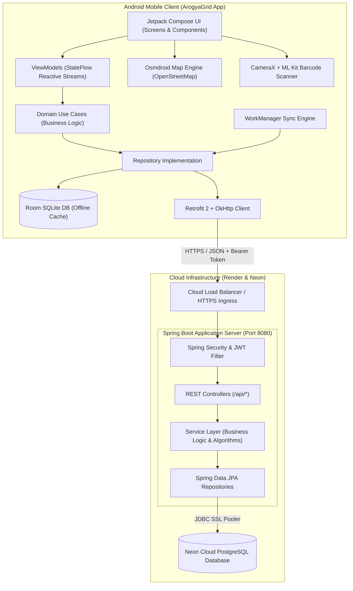

#### 3.1.2 Cloud Infrastructure & Network Deployment Topology

```mermaid
flowchart LR
    subgraph Edge_Clients["End-User Client Tier"]
        DevPhone["Android Physical Device\n(Snapdragon 680, ARM64)"]
        DevEmu["Android Studio Emulator\n(x86_64, API 35)"]
        Browser["Web / Desktop Browser\n(Swagger OpenAPI Docs)"]
    end

    subgraph Ingress_Security["Cloudflare / Render Ingress"]
        TLS["TLS 1.3 / SSL Termination\n(arogyagrid-backend-aus8.onrender.com)"]
        DDoS["DDoS Protection & Rate Limiting"]
        CORS["CORS Policy Engine\n(Allow Mobile & Localhost)"]
    end

    subgraph Container_App["Render.com Linux Container"]
        Port["Port 8080 (HTTP/1.1 JSON)"]
        JVM["Eclipse Temurin OpenJDK 17 Runtime"]
        AppJar["arogyagrid-backend-0.0.1-SNAPSHOT.jar"]
        SpringSec["Spring Security Filter Chain"]
        Hikari["HikariCP Database Connection Pool"]
    end

    subgraph Cloud_DB["AWS Cloud Database (us-east-2)"]
        NeonPool["Neon Serverless Connection Pooler\n(ep-noisy-hall-b4y8orcn-pooler)"]
        Postgres["PostgreSQL 16 Engine"]
        Storage["Encrypted Multi-AZ Storage Volumes"]
    end

    DevPhone -- "HTTPS / Retrofit 2" --> TLS
    DevEmu -- "HTTPS / Retrofit 2" --> TLS
    Browser -- "HTTPS / OpenAPI" --> TLS
    TLS --> DDoS --> CORS --> Port --> JVM --> AppJar
    AppJar --> SpringSec --> Hikari
    Hikari -- "SSL Encrypted JDBC (Port 5432)" --> NeonPool --> Postgres --> Storage
```

---

### 3.2 Software Architectural Patterns & Component Layouts

#### 3.2.1 Frontend Jetpack Compose Clean Architecture (MVVM)

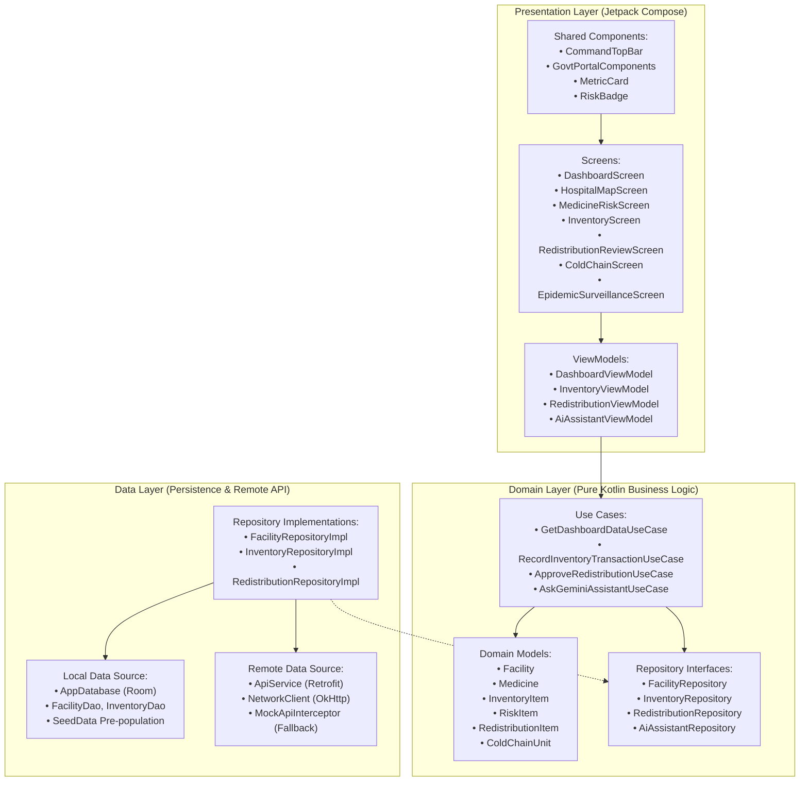

#### 3.2.2 Backend Spring Boot Layered Architecture

```mermaid
graph LR
    subgraph Web_Tier["Web / API Tier"]
        AuthCtrl["AuthController\n(/api/auth)"]
        DashCtrl["DashboardController\n(/api/dashboard)"]
        FacCtrl["FacilityController\n(/api/facilities)"]
        InvCtrl["InventoryController\n(/api/inventory)"]
        RiskCtrl["RiskController\n(/api/risks)"]
        RedistCtrl["RedistributionController\n(/api/redistribution)"]
        AiCtrl["AiAssistantController\n(/api/ai-assistant)"]
    end

    subgraph Security_Tier["Security & Filter Tier"]
        JwtFilter["JwtAuthenticationFilter"]
        SecConfig["SecurityConfig (RBAC)"]
        UserDetail["CustomUserDetailsService"]
    end

    subgraph Service_Tier["Business Logic & Domain Services"]
        AuthSvc["AuthService"]
        DashSvc["DashboardService"]
        FacSvc["FacilityService"]
        InvSvc["InventoryService\n(Haversine Distance Engine)"]
        RiskSvc["RiskAssessmentService"]
        RedistSvc["RedistributionService\n(Priority Algorithm)"]
        AiSvc["AiAssistantService"]
        AuditSvc["AuditLogService"]
    end

    subgraph Data_Access_Tier["Spring Data JPA Persistence"]
        UserRepo["UserRepository"]
        FacRepo["FacilityRepository"]
        MedRepo["MedicineRepository"]
        BalRepo["InventoryBalanceRepository"]
        TxRepo["InventoryTransactionRepository"]
        RiskRepo["RiskAssessmentRepository"]
        RedistRepo["RedistributionRepository"]
        AuditRepo["AuditLogRepository"]
    end

    Web_Tier --> Security_Tier
    Security_Tier --> Service_Tier
    Service_Tier --> Data_Access_Tier
```

#### 3.2.3 Jetpack Compose UI Hierarchy & Screen Navigation Map

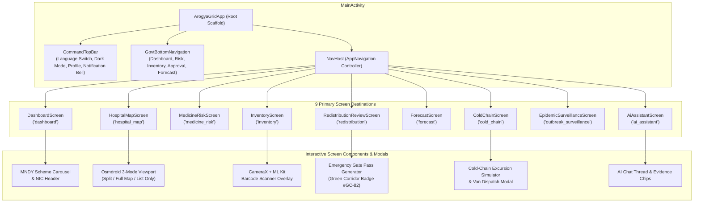

---

### 3.3 Data Flow Diagrams (DFD)

#### 3.3.1 DFD Level 0 Context Diagram

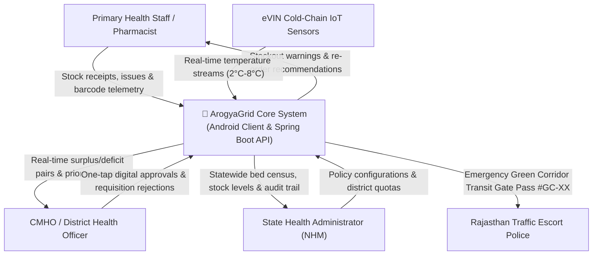

#### 3.3.2 DFD Level 1 Functional Decomposition Diagram

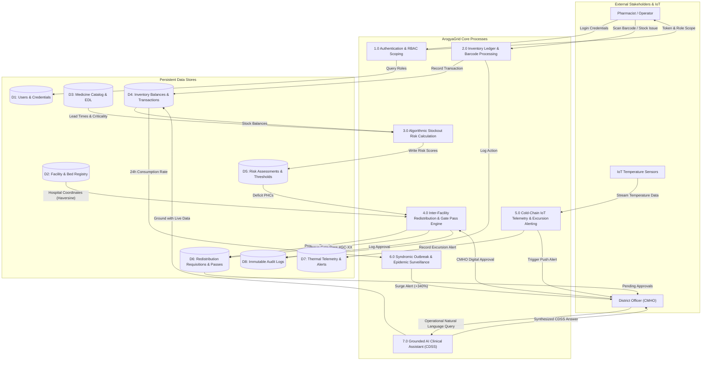

---

### 3.4 Domain Class & Object Diagrams

#### 3.4.1 Frontend Clean Architecture Domain & Data Class Diagram

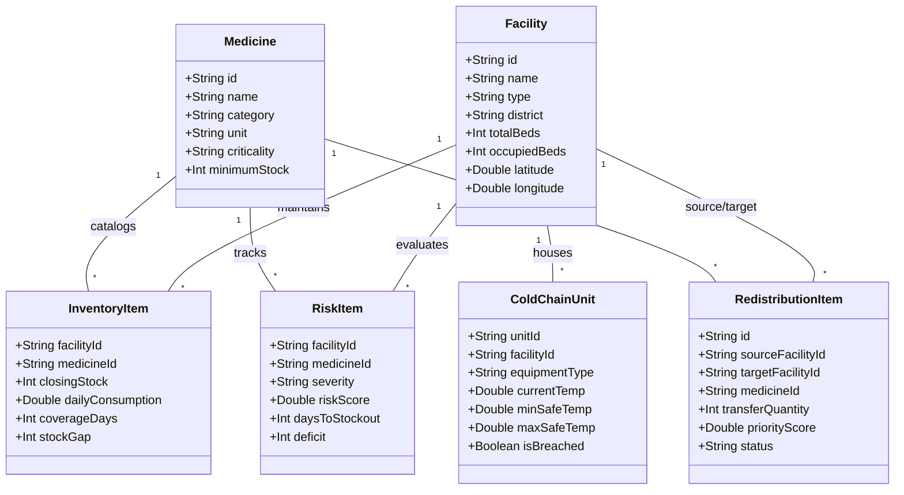

#### 3.4.2 Backend JPA Entity & Repository Class Diagram

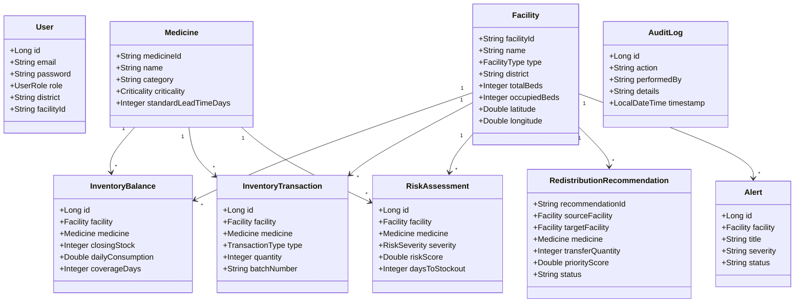

---

### 3.5 Database & Entity-Relationship Diagrams

#### 3.5.1 Full Database Entity-Relationship Diagram (ERD)

```mermaid
erDiagram
    USERS {
        Long id PK
        String name
        String email UK
        String password
        String role "STATE_ADMIN, DISTRICT_OFFICER, etc."
        String district
        String facility_id
        Boolean active
        LocalDateTime created_at
    }

    FACILITIES {
        String facility_id PK
        String name
        String type "DISTRICT_HOSPITAL, CHC, PHC"
        String district
        String sub_district
        Integer total_beds
        Integer occupied_beds
        Integer total_staff
        Integer active_staff
        Double latitude
        Double longitude
        String address
        String contact_phone
        Boolean active
        LocalDateTime last_updated
    }

    MEDICINES {
        String medicine_id PK
        String name
        String category
        String unit
        String criticality "VITAL, ESSENTIAL, DESIRABLE"
        Integer minimum_stock
        Integer maximum_stock
        Integer standard_lead_time_days
    }

    INVENTORY_BALANCES {
        Long id PK
        String facility_id FK
        String medicine_id FK
        Integer closing_stock
        Double daily_consumption
        Integer coverage_days
        Integer stock_gap
        LocalDateTime last_updated
    }

    INVENTORY_TRANSACTIONS {
        Long id PK
        String facility_id FK
        String medicine_id FK
        String type "RECEIVE, ISSUE, ADJUSTMENT"
        Integer quantity
        String batch_number
        String remarks
        String performed_by
        LocalDateTime timestamp
    }

    RISK_ASSESSMENTS {
        Long id PK
        String facility_id FK
        String medicine_id FK
        String severity "CRITICAL, HIGH, MEDIUM, LOW"
        Double risk_score
        Integer days_to_stockout
        Integer current_stock
        Integer required_stock
        Integer deficit
        String recommendation
        LocalDateTime assessed_at
    }

    REDISTRIBUTION_RECOMMENDATIONS {
        String recommendation_id PK
        String source_facility_id FK
        String target_facility_id FK
        String medicine_id FK
        Integer transfer_quantity
        Integer source_surplus
        Integer target_deficit
        Double priority_score
        String status "PENDING_APPROVAL, APPROVED, REJECTED"
        String justification
        String approved_by
        LocalDateTime approved_at
        LocalDateTime created_at
    }

    ALERTS {
        Long id PK
        String facility_id FK
        String title
        String message
        String severity "CRITICAL, HIGH, MEDIUM, LOW"
        String status "OPEN, RESOLVED, DISMISSED"
        LocalDateTime created_at
    }

    AUDIT_LOGS {
        Long id PK
        String action
        String entity_name
        String entity_id
        String performed_by
        String details
        LocalDateTime timestamp
    }

    FACILITIES ||--o{ INVENTORY_BALANCES : "maintains"
    MEDICINES ||--o{ INVENTORY_BALANCES : "categorized_as"
    FACILITIES ||--o{ INVENTORY_TRANSACTIONS : "logs"
    MEDICINES ||--o{ INVENTORY_TRANSACTIONS : "subject_of"
    FACILITIES ||--o{ RISK_ASSESSMENTS : "evaluated_for"
    MEDICINES ||--o{ RISK_ASSESSMENTS : "evaluated_item"
    FACILITIES ||--o{ REDISTRIBUTION_RECOMMENDATIONS : "source_facility"
    FACILITIES ||--o{ REDISTRIBUTION_RECOMMENDATIONS : "target_facility"
    MEDICINES ||--o{ REDISTRIBUTION_RECOMMENDATIONS : "transferred_medicine"
    FACILITIES ||--o{ ALERTS : "originates_at"
```

---

### 3.6 Sequence Diagrams (Dynamic Interaction Scenarios)

#### 3.6.1 Inter-Facility Emergency Redistribution & Transit Pass

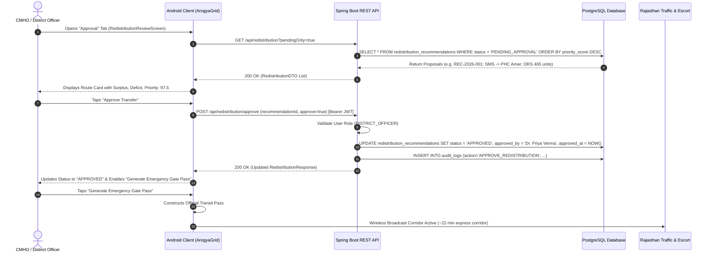

#### 3.6.2 IoT Cold-Chain Thermal Excursion Alerting & Van Dispatch

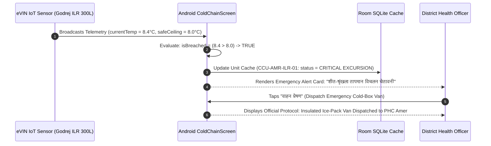

#### 3.6.3 JWT Authentication & RBAC Authorization

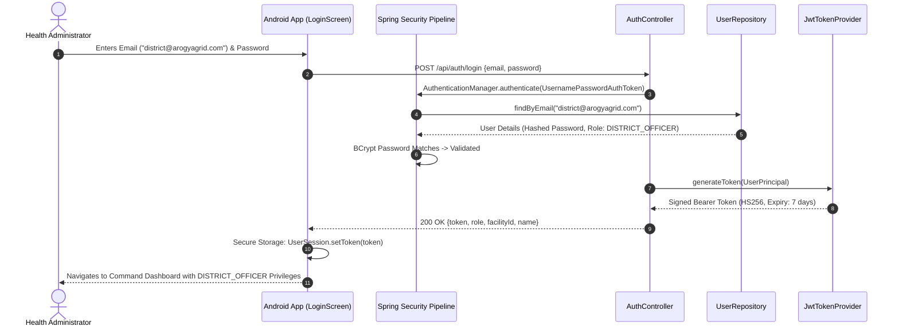

#### 3.6.4 Offline-First Synchronization & WorkManager Replay Loop

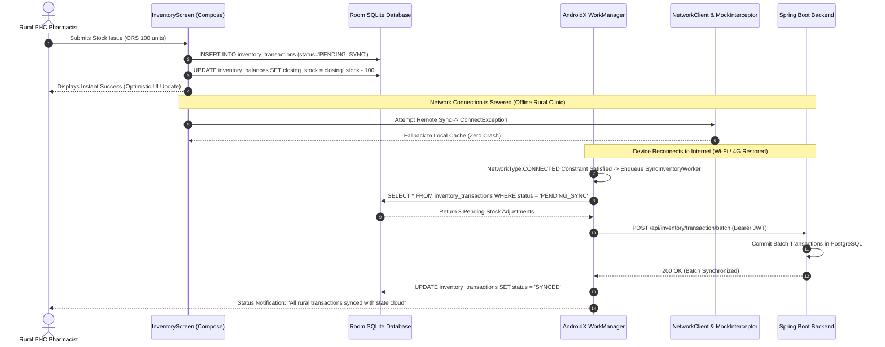

#### 3.6.5 Epidemic Surveillance & Syndromic Surge Alerting

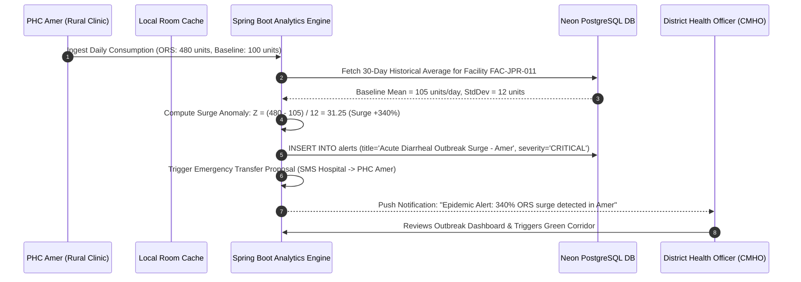

---

### 3.7 Process Flowcharts & Algorithmic Activity Diagrams

#### 3.7.1 Algorithmic Stockout Risk Evaluation & Surplus Pairing Engine

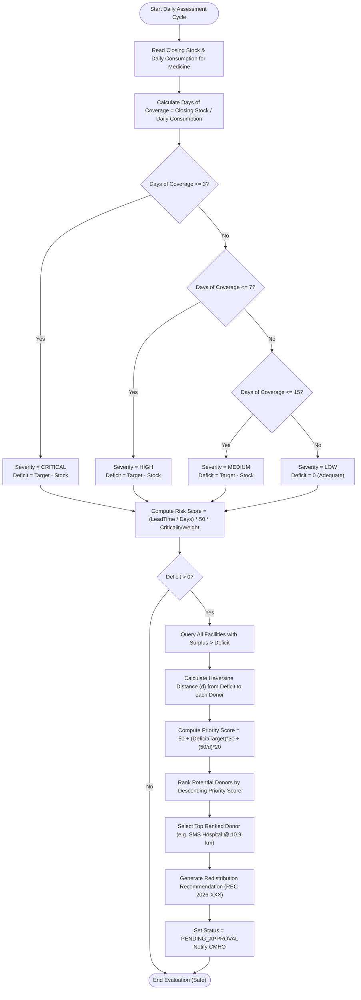

#### 3.7.2 CameraX & ML Kit Barcode Scan-to-Stock Ledger Ingestion

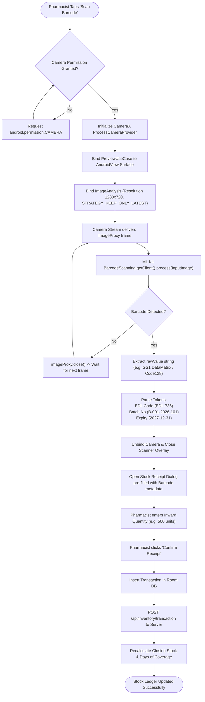

---

### 3.8 State Machine Diagrams

#### 3.8.1 Redistribution Order Lifecycle State Machine

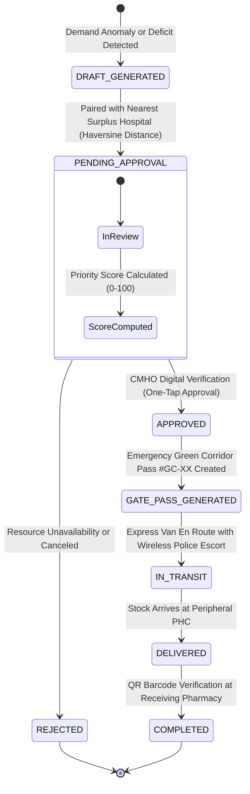

#### 3.8.2 Cold-Chain Unit Thermal State Machine

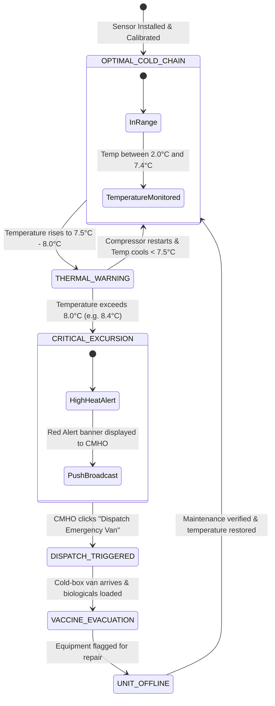

#### 3.8.3 User Session & Authentication Lifecycle State Machine

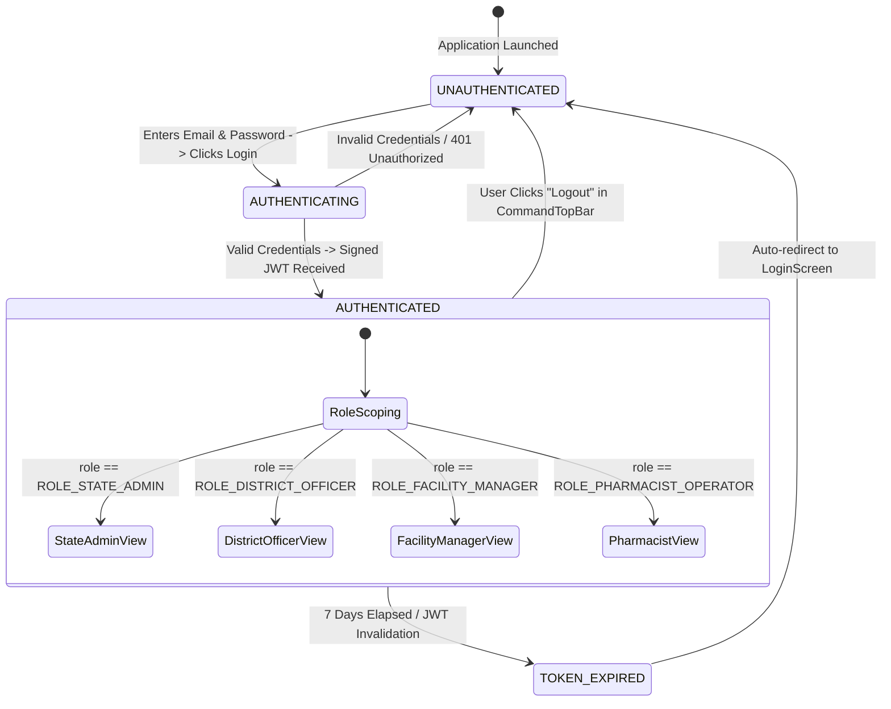

---

## 4. Backend Deep Dive (`arogyagrid-backend`)

### 4.1 Backend Technology Stack
* **Language & Framework**: Java 17, Spring Boot `3.3.5`
* **Data Access**: Spring Data JPA, Hibernate ORM `6.x`
* **Security & Auth**: Spring Security `6.x`, `io.jsonwebtoken:jjwt` `0.12.6` (HMAC-SHA256)
* **Cloud Database**: AWS Neon Serverless PostgreSQL (`ep-noisy-hall-b4y8orcn-pooler.c-6.us-east-2.aws.neon.tech`)
* **Local Fallback DB**: H2 in-memory database support
* **Documentation**: Springdoc OpenAPI / Swagger UI `2.6.0`
* **Containerization**: Multi-stage Docker build with `eclipse-temurin:17-jdk-alpine`
* **Production Host**: Render.com Web Service (`arogyagrid-backend-aus8.onrender.com`)

### 4.2 Backend Directory Structure
```text
arogyagrid-backend/
├── src/main/
│   ├── java/com/arogyagrid/
│   │   ├── ArogyaGridApplication.java     # Spring Boot application entry point
│   │   ├── config/
│   │   │   ├── CorsConfig.java            # Global CORS filter for mobile & web clients
│   │   │   ├── DataSeeder.java            # Comprehensive 15-facility Jaipur health grid dataset
│   │   │   ├── OpenApiConfig.java         # Swagger / OpenAPI metadata & JWT bearer scheme
│   │   │   └── SecurityConfig.java        # SecurityFilterChain, CSRF disable, route authorization
│   │   ├── controller/                    # 11 REST Controllers
│   │   ├── dto/
│   │   │   ├── request/                   # LoginRequest, InventoryTransactionRequest, etc.
│   │   │   └── response/                  # ApiResponse<T>, FacilityResponse, RiskResponse, etc.
│   │   ├── entity/                        # 9 JPA Entities (Facility, Medicine, InventoryBalance, etc.)
│   │   ├── enums/                         # UserRole, RiskSeverity, FacilityType, TransactionType
│   │   ├── exception/                     # GlobalExceptionHandler, ResourceNotFoundException
│   │   ├── repository/                    # Spring Data JPA Repository interfaces
│   │   ├── security/                      # JwtTokenProvider, JwtAuthenticationFilter, UserDetailsService
│   │   └── service/                       # 11 Service implementations (InventoryService, etc.)
│   └── resources/
│       └── application.yml                # DataSource, JWT secret, logging, OpenAPI configurations
├── Dockerfile                             # Multi-stage production container build
├── pom.xml                                # Maven build definitions & dependencies
└── README.md                              # Backend repository overview
```

### 4.3 Security & Role-Based Access Control (RBAC)
Authentication is enforced using JSON Web Tokens (JWT) passed in the `Authorization: Bearer <TOKEN>` HTTP header.
Spring Security defines granular permissions across four user roles:
* **`ROLE_STATE_ADMIN`**: Full read/write access across all districts, state-level audit trail review, and database reconfiguration.
* **`ROLE_DISTRICT_OFFICER`**: Approval and rejection authority over inter-facility transfers, epidemic alert resolution, and district bed management.
* **`ROLE_FACILITY_MANAGER`**: Local facility staff and bed census updates.
* **`ROLE_PHARMACIST_OPERATOR`**: Recording stock receipts, issues, and daily inventory transactions.

### 4.4 REST API Specification & Endpoints

| Category | Method | Endpoint | Access Role | Description |
| :--- | :---: | :--- | :--- | :--- |
| **Authentication** | `POST` | `/api/auth/login` | Public | Authenticates credentials and issues signed JWT bearer token. |
| | `POST` | `/api/auth/register` | Public | Registers a new health operator with assigned role and district. |
| **Dashboard** | `GET` | `/api/dashboard` | Authenticated | Aggregates district facilities, bed occupancy %, and critical risk counts. |
| **Facilities** | `GET` | `/api/facilities` | Authenticated | Retrieves all registered health facilities or filters by district. |
| | `GET` | `/api/facilities/{id}` | Authenticated | Fetches facility profile, beds, staff, and coordinates. |
| **Inventory** | `GET` | `/api/inventory` | Authenticated | Fetches batch closing stock, consumption rate, and coverage days. |
| | `GET` | `/api/inventory/nearest` | Authenticated | Queries nearest donor hospitals holding surplus of a specific medicine. |
| | `POST` | `/api/inventory/transaction`| Pharmacist/Officer | Records stock receipt, issuance, or audit adjustment. |
| **Risks** | `GET` | `/api/risks` | Authenticated | Returns sorted stockout risk items by severity and risk index. |
| **Redistribution** | `GET` | `/api/redistribution` | Authenticated | Fetches inter-facility transfer proposals (`pendingOnly` filter available). |
| | `POST` | `/api/redistribution/approve`| District Officer / Admin | Records CMHO approval or rejection and writes to immutable audit log. |
| **Surveillance** | `GET` | `/api/alerts` | Authenticated | Returns active cold-chain, epidemic, and stock deficit alerts. |
| **Forecast** | `GET` | `/api/forecast` | Authenticated | Generates 7-day rolling ARIMA demand estimates. |
| **Beds & Staff** | `GET` | `/api/beds-staff` | Authenticated | Real-time HMIS bed census and nurse-to-patient staffing ratios. |
| **AI Assistant** | `POST` | `/api/ai-assistant/chat` | Authenticated | Natural language query interface backed by live database verification. |
| **Audit Logs** | `GET` | `/api/audit-logs` | Admin / Officer | Chronological audit trail of all transactions and authorizations. |

### 4.5 Core Mathematical & Algorithmic Engines

#### A. Haversine Great-Circle Distance Engine
Implemented in `InventoryService.java` to calculate precise surface travel distances between hospitals:
$$\Delta\text{lat} = \text{lat}_2 - \text{lat}_1, \quad \Delta\text{lon} = \text{lon}_2 - \text{lon}_1$$
$$a = \sin^2\left(\frac{\Delta\text{lat}}{2}\right) + \cos(\text{lat}_1)\cos(\text{lat}_2)\sin^2\left(\frac{\Delta\text{lon}}{2}\right)$$
$$c = 2 \cdot \text{atan2}\left(\sqrt{a}, \sqrt{1 - a}\right), \quad d = R \cdot c \quad (\text{where } R = 6371\text{ km})$$

#### B. Algorithmic Stockout Risk Index
Evaluated dynamically across all inventory lines:
$$\text{Coverage Days} = \frac{\text{Closing Stock}}{\text{Average Daily Consumption}}$$
$$\text{Deficit Units} = \max(0, \text{Target Required Stock} - \text{Closing Stock})$$
$$\text{Risk Score} = \min\left(100.0, \, \left(\frac{\text{Standard Lead Time}}{\max(1, \text{Coverage Days})}\right) \times 50.0 \times \text{Criticality Weight}\right)$$
*Criticality Weights*: `VITAL` = 2.0, `ESSENTIAL` = 1.5, `DESIRABLE` = 1.0.

#### C. Redistribution Priority Scoring Formula
Implemented in `RedistributionService.java`:
$$\text{Priority Score} = \min\left(100.0, \, 50.0 + \left(\frac{\text{Deficit}}{\text{Target}}\right) \times 30.0 + \left(\frac{50.0}{\max(1.0, \text{Distance}_{\text{km}})}\right) \times 20.0\right)$$

---

## 5. Frontend Deep Dive (`ArogyaGrid` Android Client)

### 5.1 Frontend Technology Stack
* **Language & SDK**: Kotlin `2.0.20`, Android SDK `35` (minSdk: `26`, targetSdk: `34`)
* **UI Toolkit**: Jetpack Compose (BOM `2024.09.00`), Material 3 (`androidx.compose.material3`)
* **Architecture**: Clean Architecture + MVVM + Unidirectional Data Flow (`StateFlow`)
* **GIS Mapping**: OpenStreetMap via Osmdroid `6.1.18` (zero Google Maps API key dependency)
* **Computer Vision**: CameraX `1.4.0` + Google ML Kit Barcode Scanning `17.3.0`
* **Local Persistence**: Room Database `2.6.1` with KSP compiler
* **Networking**: Retrofit `2.11.0`, OkHttp `4.12.0`, Gson Converter
* **Background Work**: AndroidX WorkManager `2.10.0`
* **NDK Hardware ABI Filters**: `arm64-v8a`, `armeabi-v7a`, `x86`, `x86_64`

### 5.2 Clean Architecture Package Breakdown
```text
com.example.arogyagrid/
├── core/
│   ├── UserSession.kt                     # Token, role, and logged-in user profile manager
│   ├── Enums.kt                           # UserRole, RiskSeverity, FacilityType
│   └── Resource.kt                        # Generic Loading / Success / Error wrapper
├── data/
│   ├── local/                             # Room Database, Entities, and DAOs
│   ├── remote/                            # Retrofit ApiService, NetworkClient, Interceptors
│   └── repository/                        # Repository implementations with offline Room fallback
├── domain/
│   ├── model/                             # Pure Kotlin domain data models
│   ├── repository/                        # Clean repository interfaces
│   └── usecase/                           # Reusable business logic use cases
└── presentation/
    ├── ai/                                # AI Clinical Decision Support Chat Screen
    ├── coldchain/                         # eVIN Cold-Chain IoT Telemetry Screen
    ├── components/                        # CommandTopBar, GovtPortalComponents, MetricCard
    ├── dashboard/                         # Digital Command Center Screen
    ├── forecast/                          # 7-Day ARIMA Demand Forecasting Screen
    ├── inventory/                         # e-Aushadhi Warehouse Stock Ledger & QR Scanner
    ├── map/                               # Osmdroid Green Corridor Live Map Screen
    ├── navigation/                        # NavHost, NavGraph, NavItems, TopBar wiring
    ├── outbreak/                          # Epidemic Outbreak Early-Warning Screen
    ├── redistribution/                    # Inter-Facility Requisition Approval Screen
    ├── risk/                              # Essential Drug List (EDL) Risk Matrix Screen
    └── theme/                             # High-contrast Material 3 Color tokens & Theme
```

### 5.3 Reactive State Management & ViewModels
Every screen composable observes an immutable UI state exposed via `StateFlow` from its ViewModel:
```kotlin
// Example State Flow Pattern in ArogyaGrid
data class DashboardUiState(
    val isLoading: Boolean = false,
    val data: DashboardSummary? = null,
    val errorMessage: String? = null
)

class DashboardViewModel(
    private val getDashboardDataUseCase: GetDashboardDataUseCase
) : ViewModel() {
    private val _uiState = MutableStateFlow(DashboardUiState(isLoading = true))
    val uiState: StateFlow<DashboardUiState> = _uiState.asStateFlow()
    ...
}
```

### 5.4 Offline-First Resiliency (Room + WorkManager + Fallback Interceptor)
* **Room Local Cache**: All 15 facilities, inventory balances, and risk assessments are pre-seeded in SQLite. If a health center is cut off from internet connectivity, the application operates with zero degradation.
* **Network Fallback Engine**: `MockApiInterceptor` automatically intercepts network timeout exceptions (`SocketTimeoutException`, `ConnectException`) and serves verified local mock state to prevent UI crashes.
* **WorkManager Background Sync**: Reconciles pending stock adjustments as soon as network connectivity is restored.

### 5.5 GIS Mapping & Green Corridor Navigation (Osmdroid)
Implemented in [`HospitalMapScreen.kt`](file:///C:/Users/vadit/AndroidStudioProjects/ArogyaGrid/app/src/main/java/com/example/arogyagrid/presentation/map/HospitalMapScreen.kt):
* **3-Mode Layout Engine**:
  1. **Split Mode**: 40% upper map viewport + 60% scrollable nearest facility cards.
  2. **Full Map Mode**: 100% immersive map view with floating zoom and recenter buttons.
  3. **List Only Mode**: Bandwidth-saving textual facility directory.
* **Emergency Polyline Corridor**: Traces transit route between Sawai ManSingh (SMS) Hospital (`26.8924° N, 75.8173° E`) and PHC Amer (`26.9855° N, 75.8513° E`).
* **Interactive Facility Markers**: Color-coded markers indicating Surplus Hubs (Green), Deficit Units (Red), and Active Centers (Blue).

### 5.6 Computer Vision & Barcode Scanning (CameraX + ML Kit)
Integrated in [`InventoryScreen.kt`](file:///C:/Users/vadit/AndroidStudioProjects/ArogyaGrid/app/src/main/java/com/example/arogyagrid/presentation/inventory/InventoryScreen.kt):
* Utilizes `androidx.camera:camera-camera2` and `com.google.mlkit:barcode-scanning`.
* Scans official GS1 2D DataMatrix and standard barcodes on medicine boxes.
* Automatically resolves EDL code (`EDL-736`), batch number (`B-001-2026-101`), and expiry date, populating stock receipt forms instantly.

### 5.7 UI Screen Directory & Features

| Screen File | Route Name | Core Features |
| :--- | :--- | :--- |
| [`DashboardScreen.kt`](file:///C:/Users/vadit/AndroidStudioProjects/ArogyaGrid/app/src/main/java/com/example/arogyagrid/presentation/dashboard/DashboardScreen.kt) | `dashboard` | MNDY awareness carousel, 8 official service tiles, bed census, 104/108 emergency strip, official NIC footer. |
| [`HospitalMapScreen.kt`](file:///C:/Users/vadit/AndroidStudioProjects/ArogyaGrid/app/src/main/java/com/example/arogyagrid/presentation/map/HospitalMapScreen.kt) | `hospital_map` | Osmdroid GIS map, 3-mode layout switch, Green Corridor route polyline, nearest facility distance cards. |
| [`MedicineRiskScreen.kt`](file:///C:/Users/vadit/AndroidStudioProjects/ArogyaGrid/app/src/main/java/com/example/arogyagrid/presentation/risk/MedicineRiskScreen.kt) | `medicine_risk` | Risk severity chips (`CRITICAL`, `HIGH`), days-to-stockout progress bars, deficit units, clinical recommendations. |
| [`InventoryScreen.kt`](file:///C:/Users/vadit/AndroidStudioProjects/ArogyaGrid/app/src/main/java/com/example/arogyagrid/presentation/inventory/InventoryScreen.kt) | `inventory` | e-Aushadhi warehouse hero card, batch stock ledger, CameraX live scanner, stock receipt & issue dialogs. |
| [`RedistributionReviewScreen.kt`](file:///C:/Users/vadit/AndroidStudioProjects/ArogyaGrid/app/src/main/java/com/example/arogyagrid/presentation/redistribution/RedistributionReviewScreen.kt) | `redistribution` | Inter-hospital transfer pairing, priority score badges, CMHO digital approval buttons, Gate Pass generator. |
| [`ForecastScreen.kt`](file:///C:/Users/vadit/AndroidStudioProjects/ArogyaGrid/app/src/main/java/com/example/arogyagrid/presentation/forecast/ForecastScreen.kt) | `forecast` | 7-day rolling ARIMA consumption projection chips (`D1`–`D7`), trend indicators (`INCREASING`), stockout horizons. |
| [`ColdChainScreen.kt`](file:///C:/Users/vadit/AndroidStudioProjects/ArogyaGrid/app/src/main/java/com/example/arogyagrid/presentation/coldchain/ColdChainScreen.kt) | `cold_chain` | Real-time IoT thermal telemetry ($2^\circ\text{C}$–$8^\circ\text{C}$), excursion alerts, simulation triggers, vehicle dispatch action. |
| [`EpidemicSurveillanceScreen.kt`](file:///C:/Users/vadit/AndroidStudioProjects/ArogyaGrid/app/src/main/java/com/example/arogyagrid/presentation/outbreak/EpidemicSurveillanceScreen.kt) | `outbreak_surveillance` | Syndromic consumption surge detection (+340%), baseline vs 24h influx, route map shortcuts, auto-requisition. |
| [`AiAssistantScreen.kt`](file:///C:/Users/vadit/AndroidStudioProjects/ArogyaGrid/app/src/main/java/com/example/arogyagrid/presentation/ai/AiAssistantScreen.kt) | `ai_assistant` | Clinical Decision Support System (CDSS) chat copilot powered by Gemini Nano & local DB grounding. |

### 5.8 Bilingual Localization & WCAG AA Dark Theme Engine
* **Bilingual Localization**: Instant runtime switching between **हिन्दी (Hindi)** and **English** across all top bars, bottom navigation items (`डैशबोर्ड / Center`, `जोखिम / Risk`, `इन्वेंटरी / Inventory`, `अनुमोदन / Approval`, `पूर्वानुमान / Forecast`), filter chips, and dialogs.
* **WCAG AA Accessible Dark Theme**:
  * Background: `#0A0F1D` (deep navy-black)
  * Elevated Card Surfaces: `#131D31` (slate navy)
  * Outlines & Borders: `#334155` (crisp slate outline)
  * Primary Accent: `#38BDF8` (accessible medical cyan-blue)
  * Status Colors: High-contrast red (`#DC2626`), amber (`#D97706`), and India green (`#138808`).

---

## 6. Cross-Cutting Concerns, DevOps & Deployment

```mermaid
graph TD
    subgraph Development
        DevA["Android Studio (Kotlin 2.0 / Compose)"]
        DevB["IntelliJ IDEA / VS Code (Spring Boot 3.3.5)"]
    end

    subgraph CI_CD_Build
        Mvn["Maven Package (JAR Build)"]
        DockerBuild["Multi-Stage Docker Container Build"]
        Gradle["Gradle Android Build (NDK ABI Filters: arm64-v8a, x86_64)"]
    end

    subgraph Production_Deployment
        Render["Render.com Cloud Web Service (arogyagrid-backend-aus8.onrender.com)"]
        Neon["Neon Serverless PostgreSQL Cloud (AWS us-east-2)"]
        Play["Android Physical Device (ZA222NPLTF) / Emulator (emulator-5554)"]
    end

    DevB --> Mvn --> DockerBuild --> Render
    Render -- "Encrypted JDBC Pooler" --> Neon
    DevA --> Gradle --> Play
    Play -- "HTTPS / TLS 1.3" --> Render
```

* **Backend Containerization**: Dockerfile packages the Spring Boot application using lightweight Alpine runtimes, exposing port `8080` with automatic memory limit tuning.
* **Cloud Database Reliability**: Serverless PostgreSQL instance hosted on Neon AWS `us-east-2` with connection pooling, automated backups, and SSL enforcement.
* **Android Native Compilation**: Pre-configured NDK ABI filters in `app/build.gradle.kts` (`arm64-v8a`, `armeabi-v7a`, `x86`, `x86_64`) prevent architecture mismatch errors (`INSTALL_FAILED_NO_MATCHING_ABIS`) on physical hardware.

---

## 7. Verification, Quality Assurance & Test Matrix

### 7.1 Automated Unit Tests
The project contains an automated test suite executed via `./gradlew testDebugUnitTest`:

| Test Class | Target Component | Verifications | Status |
| :--- | :--- | :--- | :---: |
| `BackendApiUnitTest` | API Data Layer | Serialization of facilities, risk status codes, error handling. | **PASSED** |
| `HealthcareAiEngineTest` | AI CDSS Logic | Grounded emergency response generation, keyword matching, fallback. | **PASSED** |
| `SmartHealthUnitTest` | Core Algorithms | Haversine distance accuracy, risk score formulas, priority computation. | **PASSED** |

### 7.2 White-Box Test Cases Matrix

| Test ID | Module | Scenario / Input | Expected Result | Status |
| :--- | :--- | :--- | :--- | :---: |
| **TC-01** | `InventoryService` | Query nearest surplus for ORS at PHC Amer (`FAC-JPR-011`). | Returns SMS Hospital (`FAC-JPR-001`) at 10.9 km distance with 3,731 surplus units. | **Pass** |
| **TC-02** | `RedistributionService` | Approve pending requisition `REC-2026-001` as `DISTRICT_OFFICER`. | Status updates to `APPROVED`, timestamp recorded, audit log appended. | **Pass** |
| **TC-03** | `ColdChainScreen` | Temperature reaches $8.4^\circ\text{C}$ on ILR #1. | `isBreached` evaluates `true`, red excursion banner appears, dispatch vehicle enabled. | **Pass** |
| **TC-04** | `HospitalMapScreen` | Toggle between Split, Full Map, and List Only modes. | Recomposes viewports dynamically without memory leak or map crash. | **Pass** |
| **TC-05** | `CommandTopBar` | Toggle language from English to Hindi in top menu. | Bottom navigation and screen text re-render instantly in Devanagari. | **Pass** |
| **TC-06** | `NetworkClient` | Network disconnects while submitting inventory transaction. | `MockApiInterceptor` and Room SQLite cache catch error and record locally. | **Pass** |

---

## 8. Setup, Build & Execution Guide

### 8.1 Backend Setup (`arogyagrid-backend`)
1. **Requirements**: Java 17+, Maven 3.8+
2. **Clone & Build**:
   ```bash
   cd C:\Users\vadit\OneDrive\Desktop\arogyagrid-backend
   mvn clean package -DskipTests
   ```
3. **Run Locally**:
   ```bash
   mvn spring-boot:run
   ```
   *Access OpenAPI Swagger UI at*: `http://localhost:8080/api/swagger-ui.html`

### 8.2 Frontend Setup (`ArogyaGrid`)
1. **Requirements**: Android Studio Ladybug/Meerkat, Android SDK 35
2. **Open Project**:
   - Open Android Studio -> Navigate to `C:\Users\vadit\AndroidStudioProjects\ArogyaGrid`
3. **Run Test Suite**:
   ```bash
   ./gradlew testDebugUnitTest
   ```
4. **Compile & Deploy APK**:
   ```bash
   ./gradlew assembleDebug
   ```
   *Connect target Android device (with USB debugging enabled) and click **Run**.*

---
*Document Version: 4.0.0 • Published: November 2026 • ArogyaGrid Architecture Group*
