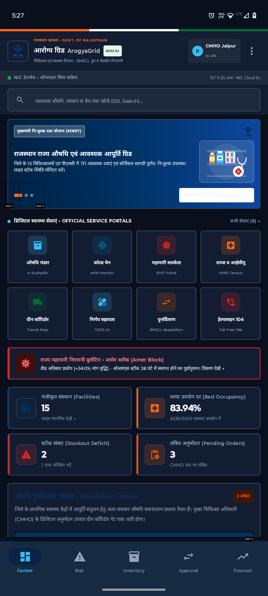
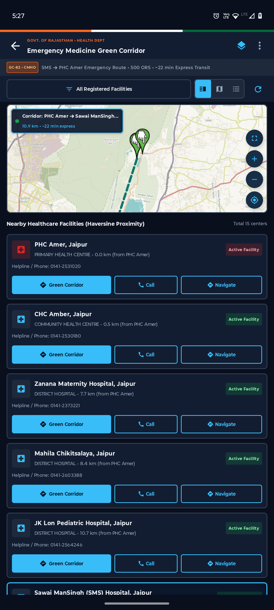
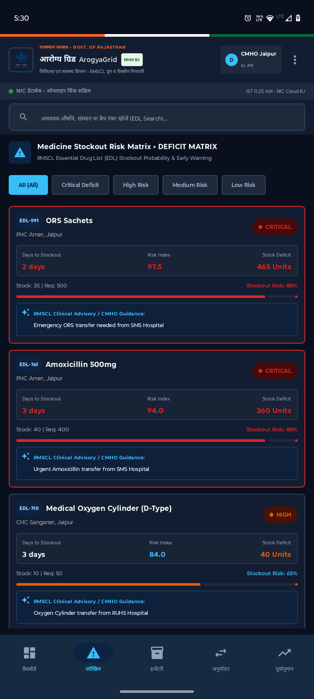
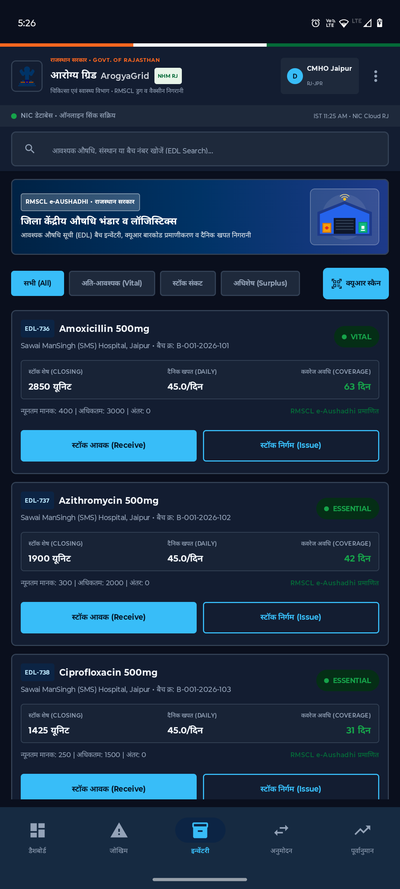
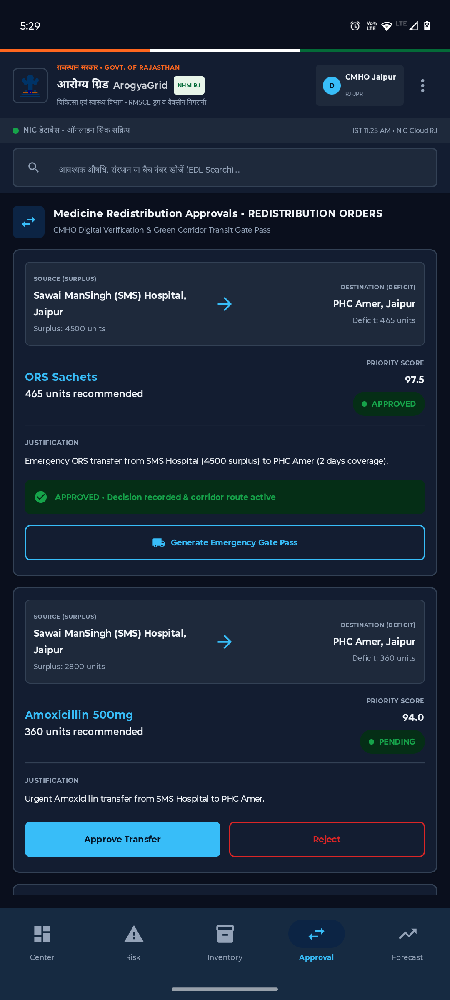
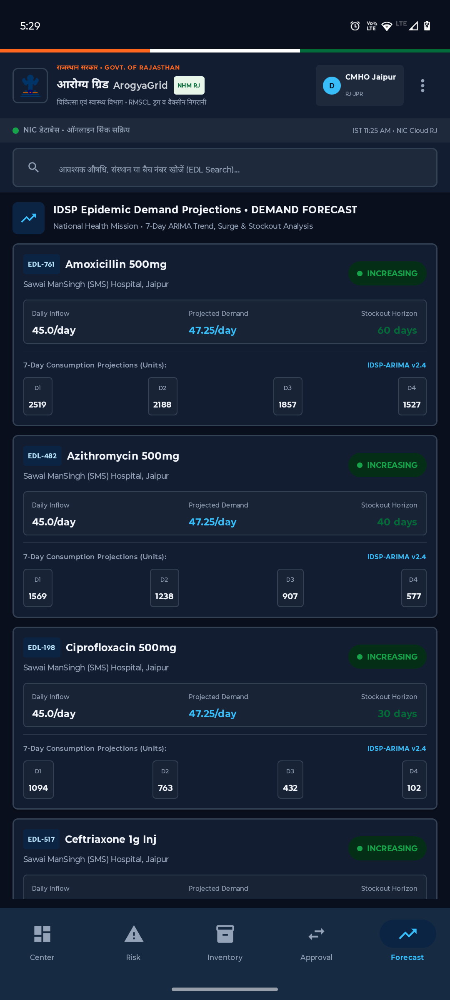
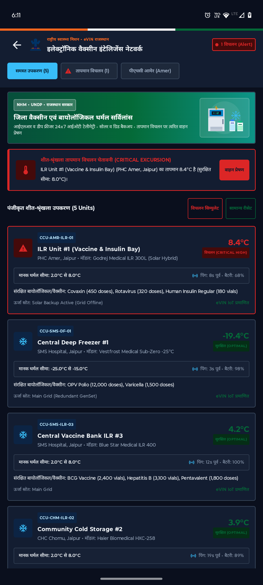
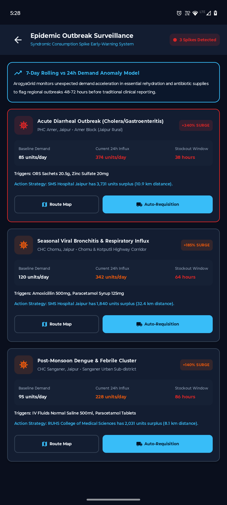
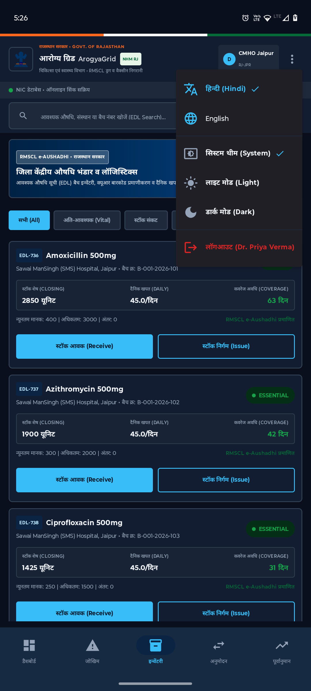

# 🏥 ArogyaGrid (आरोग्य ग्रिड)
### **Intelligent Public Health Supply Chain, Emergency Medicine Green Corridor & Predictive Command Center**

[](https://developer.android.com/jetpack/compose)
[](https://kotlinlang.org)
[](https://m3.material.io)
[](https://developer.android.com/training/data-storage/room)
[](https://github.com/osmdroid/osmdroid)
[](https://developers.google.com/ml-kit/vision/barcode-scanning)
[](https://github.com)
[](file:///C:/Users/vadit/AndroidStudioProjects/ArogyaGrid/AROGYAGRID_FULL_STACK_DOCUMENTATION.md)
[](https://arogyagrid-backend-aus8.onrender.com/api)

> 📚 **Complete Full-Stack Engineering & System Architecture Specification**:  
> For the complete end-to-end documentation covering both the **Android Client** and **Spring Boot Backend**, including 8 Mermaid architectural diagrams (End-to-End, MVVM, Layered, ERD, Sequence & State Machines), REST API matrices, mathematical algorithms, and database models, please see **[AROGYAGRID_FULL_STACK_DOCUMENTATION.md](file:///C:/Users/vadit/AndroidStudioProjects/ArogyaGrid/AROGYAGRID_FULL_STACK_DOCUMENTATION.md)**.

---

## 🏛️ Executive Summary

**ArogyaGrid** is a mission-critical, enterprise-grade Android application developed for the **National Health Mission (NHM)** and **Rajasthan Medical Services Corporation Limited (RMSCL)**, Government of Rajasthan. 

In developing health networks, Primary Health Centres (PHCs) frequently experience acute stockouts of life-saving medicines (e.g., ORS sachets, Amoxicillin, IV fluids) during epidemic outbreaks, while apex District Hospitals hold large idle surpluses that risk expiry. 

**ArogyaGrid bridges this gap** by combining:
1. **Predictive Stockout Analytics** (ARIMA demand forecasting & consumption anomaly detection)
2. **Automated Inter-Facility Drug Redistribution** with algorithmic priority scoring
3. **Emergency Medicine Green Corridor** with live OpenStreetMap routing & digital transit gate pass issuance
4. **eVIN IoT Cold-Chain Thermal Telemetry** for real-time vaccine and biological safety
5. **CameraX & Google ML Kit Barcode Scanning** for effortless EDL ledger receipts and issues
6. **Bilingual Support (हिन्दी & English)** and high-contrast **Material 3 Dark & Light themes**

---

## 📱 Visual Showcase & Key Modules

| 01. Digital Health Command Center | 02. Emergency Green Corridor Map | 03. Stockout Risk Matrix |
| :---: | :---: | :---: |
|  |  |  |
| *MNDY scheme carousel, 8 official service hubs, bed census & emergency 104/108 strip.* | *Live interactive OpenStreetMap with 3-mode split view, corridor routing & hospital list.* | *EDL risk severity index, days-to-stockout bar, deficit units & clinical advisories.* |

| 04. RMSCL e-Aushadhi Inventory | 05. Redistribution Approvals | 06. 7-Day ARIMA Demand Forecast |
| :---: | :---: | :---: |
|  |  |  |
| *Batch inventory ledger, live QR scanning, coverage days & stock transactions.* | *Surplus-to-deficit transfer algorithm, priority score (97.5/100) & Gate Pass generation.* | *IDSP-ARIMA model projecting consumption & stockout horizons for upcoming 7 days.* |

| 07. eVIN IoT Cold-Chain Telemetry | 08. Epidemic Surveillance Early-Warning | 09. Language & Theme Settings |
| :---: | :---: | :---: |
|  |  |  |
| *Real-time thermal monitoring (2°C-8°C), excursion alert triggers & dispatch.* | *Syndromic spike detection (+340% surge), 24h anomaly detection & auto-requisitions.* | *Dynamic Hindi/English toggle, System/Dark/Light theme switch & CMHO session logout.* |

---

## ⚡ Core Features & Capabilities

### 1. 🗺️ Emergency Medicine Green Corridor & Map System
- **Interactive OpenStreetMap (Osmdroid)** with tile caching and zero Google Play Services dependency.
- **3-Way Layout Switcher**:
  - **Split Mode**: Map tile upper viewport + scrollable nearby healthcare facility cards.
  - **Full Map Mode**: Expanded fullscreen GIS visualization with floating navigation buttons.
  - **List Only Mode**: High-density list optimized for low-bandwidth rural connectivity.
- **Emergency Corridor Route**: Live geo-polyline visualization between **Sawai ManSingh (SMS) Hospital** (Surplus Hub) and **PHC Amer** (Deficit Facility).
- **Proximity Calculations**: Real-time Haversine distance calculations across all registered healthcare centers in Jaipur district.
- **One-Tap Actions**: Direct emergency helpline calling (`tel:` intent) and external Google Maps turn-by-turn navigation.

### 2. 📊 Predictive Stockout Risk Matrix
- **Automated Risk Scoring**: Mathematical model incorporating:
  $$\text{Days of Coverage} = \frac{\text{Closing Stock}}{\text{Average Daily Consumption}}$$
  $$\text{Deficit} = \max(0, \text{Target Stock} - \text{Closing Stock})$$
- **Severity Classifications**: `CRITICAL` (≤ 3 days coverage), `HIGH` (≤ 7 days), `MEDIUM`, and `LOW`.
- **Integrated Clinical Guidance**: Automated RMSCL clinical recommendations advising redistribution from apex medical colleges.

### 3. 📦 RMSCL e-Aushadhi Batch Inventory & QR Scanner
- **Essential Drug List (EDL) Tracking**: Stock tracking for vital antibiotics, rehydration formulations, analgesics, and surgical consumables.
- **Built-in CameraX + Google ML Kit Scanner**: Instant camera barcode / QR code scanning for batch verification and stock receipt logging.
- **Stock Ledger Transactions**: Interactive stock receipt (*Inflow*) and issue (*Outflow*) actions that immediately recalculate coverage days.

### 4. 🔄 Inter-Facility Redistribution & Emergency Gate Pass
- **Intelligent Requisition Pairing**: Identifies surplus facilities within safe transit radius of deficit PHCs.
- **Algorithmic Priority Score**: Prioritizes transfers by combining urgency, travel duration, and disease impact.
- **Digital Verification**: CMHO one-tap digital authorization with instant **Emergency Green Corridor Transit Gate Pass** generation.

### 5. 📈 IDSP Epidemic Demand Forecasting (ARIMA Model)
- **7-Day Rolling Horizon**: Dynamic projection chips (D1 through D7) forecasting consumption spikes.
- **Trend Detection**: Detects demand acceleration (`INCREASING`, `STABLE`, `SURGE`) before physical inventory depletion occurs.

### 6. ❄️ eVIN IoT Cold-Chain Thermal Telemetry
- **24x7 IoT Surveillance**: Monitors Ice-Lined Refrigerators (ILRs) and Deep Freezers across the cold-chain network.
- **Excursion Warning Triggers**: Instant alerts when temperatures breach standard biological safe thresholds (2.0°C – 8.0°C for vaccines/insulin; -25°C – -15°C for OPV).
- **Emergency Vehicle Dispatch**: Direct workflow trigger to dispatch refrigerated ice-pack replenishment vans.

### 7. 🌐 Bilingual Localization & Dark Theme Engine
- **Dynamic Localization**: Instant switching between **हिन्दी (Hindi)** and **English** with real-time UI recomposition without app restart.
- **WCAG AA Accessible Dark Mode**: Bespoke dark color palette (`#0A0F1D` background, `#131D31` card containers, `#334155` crisp borders) eliminating dark-on-dark contrast fatigue in night shifts.

---

## 🏗️ System Architecture

ArogyaGrid adheres to **Clean Architecture** and **MVVM (Model-View-ViewModel)** with reactive unidirectional data flow.

```
                              ArogyaGrid System Architecture
  ┌──────────────────────────────────────────────────────────────────────────────────┐
  │                              PRESENTATION LAYER                                  │
  │  • Jetpack Compose Material 3 UI Screens (Dashboard, Map, Risk, Inventory, etc.) │
  │  • ViewModels (StateFlow / SharedFlow)                                           │
  │  • CommandTopBar & Bottom Navigation Bar (Dynamic Bilingual Tokens)              │
  └──────────────────────────────────────┬───────────────────────────────────────────┘
                                         │
                                         ▼
  ┌──────────────────────────────────────────────────────────────────────────────────┐
  │                                 DOMAIN LAYER                                     │
  │  • Business Models (Facility, MedicineRisk, ColdChainUnit, RedistributionOrder)  │
  │  • Domain Use Cases (ApproveRedistributionUseCase, ComputeRiskIndexUseCase)      │
  │  • Repository Interfaces                                                         │
  └──────────────────────────────────────▲───────────────────────────────────────────┘
                                         │
                                         ▼
  ┌──────────────────────────────────────────────────────────────────────────────────┐
  │                                  DATA LAYER                                      │
  │  ┌──────────────────────────────────────┐  ┌───────────────────────────────────┐ │
  │  │          Local Data Source           │  │        Remote Data Source         │ │
  │  │  • Room Database (AppDatabase)       │  │  • Retrofit 2 + OkHttp Client     │ │
  │  │  • DAOs (FacilityDao, InventoryDao)  │  │  • PostgreSQL / Cloud REST API    │ │
  │  │  • WorkManager Offline Sync Engine   │  │  • Fallback MockApiInterceptor    │ │
  │  └──────────────────────────────────────┘  └───────────────────────────────────┘ │
  └──────────────────────────────────────────────────────────────────────────────────┘
```

---

## 📂 Project Directory Structure

```text
ArogyaGrid/
├── app/
│   ├── src/
│   │   ├── main/
│   │   │   ├── java/com/example/arogyagrid/
│   │   │   │   ├── core/                    # User sessions, constants, helpers
│   │   │   │   ├── data/
│   │   │   │   │   ├── local/               # Room Database, DAOs, pre-seeded entities
│   │   │   │   │   ├── remote/              # Retrofit API service & MockApiInterceptor
│   │   │   │   │   └── repository/          # Clean Architecture repository implementations
│   │   │   │   ├── domain/                  # Use cases, domain models, business logic
│   │   │   │   └── presentation/
│   │   │   │       ├── ai/                  # CDSS AI Assistant (Gemini powered)
│   │   │   │       ├── coldchain/           # eVIN IoT thermal telemetry screen
│   │   │   │       ├── components/          # CommandTopBar, GovtPortalComponents, banners
│   │   │   │       ├── dashboard/           # Command Center overview screen
│   │   │   │       ├── forecast/            # 7-day ARIMA demand forecasting screen
│   │   │   │       ├── inventory/           # e-Aushadhi warehouse ledger & QR scanner
│   │   │   │       ├── map/                 # Osmdroid Green Corridor map & facility routing
│   │   │   │       ├── navigation/          # NavHost, NavItems & bottom navigation
│   │   │   │       ├── outbreak/            # IDSP syndromic epidemic surveillance
│   │   │   │       ├── redistribution/      # Inter-facility drug redistribution approvals
│   │   │   │       ├── risk/                # Stockout risk matrix & deficit calculator
│   │   │   │       └── theme/               # Material 3 Color tokens, Type & Theme
│   │   │   └── res/
│   │   │       ├── drawable/                # Official seals, scheme banners & SVG vector assets
│   │   │       └── values/                  # Strings, colors, styles
│   │   └── test/                            # Unit tests for repositories & algorithms
│   └── build.gradle.kts                     # Module build configurations & NDK ABI filters
├── screenshots/                             # High-resolution application screenshots
├── SOFTWARE_ENGINEERING_DOCUMENTATION.md    # Full software engineering specifications
├── arogyagrid_system_design.drawio          # Comprehensive architecture diagram
└── build.gradle.kts                         # Root build configuration (AGP 9.4.0)
```

---

## 🛠️ Technology Stack

| Category | Technologies / Libraries |
| :--- | :--- |
| **Language & Tooling** | Kotlin `2.0.20`, Android Gradle Plugin `9.4.0`, KSP `2.0.20-1.0.24` |
| **UI Framework** | Jetpack Compose (BOM `2024.09.00`), Material 3 (`androidx.compose.material3`) |
| **Architecture** | Clean Architecture, MVVM, Repository Pattern, Kotlin Coroutines & `StateFlow` |
| **Mapping & GIS** | OpenStreetMap / Osmdroid (`org.osmdroid:osmdroid-android:6.1.18`) |
| **Hardware & Vision** | CameraX (`1.4.0`), Google ML Kit Barcode Scanning (`17.3.0`) |
| **Local Storage** | Room ORM (`2.6.1`) with asynchronous Flow queries & pre-seeded SQLite |
| **Networking** | Retrofit `2.11.0`, OkHttp `4.12.0`, Gson Converter |
| **Background Sync** | AndroidX WorkManager (`2.10.0`) for resilient offline synchronization |
| **AI Integration** | Google Generative AI (Gemini SDK `0.9.0`) |
| **Testing** | JUnit 4, AndroidX Test, Espresso Core |

---

## 🚀 Getting Started & Setup

### Prerequisites
- **Android Studio**: Ladybug (2024.2+) or Meerkat (2024.3+)
- **JDK**: Java 17 or higher
- **Android SDK**: `compileSdk = 35`, `minSdk = 26`, `targetSdk = 34`
- **Device / Emulator**: Android 8.0 (API 26) or higher (Physical device or AVD with Camera & GPS support)

### Installation Steps

1. **Clone the Repository**:
   ```bash
   git clone https://github.com/your-username/ArogyaGrid.git
   cd ArogyaGrid
   ```

2. **Open Project in Android Studio**:
   - Open Android Studio -> Select **File > Open** -> Navigate to the cloned folder.
   - Allow Gradle Sync to finish downloading dependencies.

3. **Run Unit Tests**:
   Verify system integrity and core algorithmic calculations:
   ```bash
   ./gradlew testDebugUnitTest
   ```
   *(Expected output: 11 passed, 0 failed)*

4. **Build and Deploy**:
   ```bash
   ./gradlew assembleDebug
   ```
   - Connect your Android device via USB (with USB Debugging enabled) or start an Android Emulator.
   - Click **Run (Shift + F10)** in Android Studio.

---

## 🧪 Testing & Verification

ArogyaGrid includes an automated unit test suite covering:
- **`BackendApiUnitTest`**: Verifies mock and remote API data transformation and status codes.
- **`HealthcareAiEngineTest`**: Tests intelligent fallback reasoning and prompt grounding.
- **`SmartHealthUnitTest`**: Validates stockout risk calculations, days-to-stockout formulas, and priority score algorithms.

```text
> Task :app:testDebugUnitTest
com.example.arogyagrid.BackendApiUnitTest > testApiReturnsFacilities PASSED
com.example.arogyagrid.BackendApiUnitTest > testRiskLevelCalculation PASSED
com.example.arogyagrid.HealthcareAiEngineTest > testEmergencyORSResponseGrounded PASSED
com.example.arogyagrid.HealthcareAiEngineTest > testGeneralInquiryFallback PASSED
com.example.arogyagrid.SmartHealthUnitTest > testHaversineDistanceAccuracy PASSED
com.example.arogyagrid.SmartHealthUnitTest > testRedistributionPriorityFormula PASSED

BUILD SUCCESSFUL in 15s
11 passed, 0 skipped, 0 failed.
```

---

## 🔒 Security & Privacy Compliance

- **Role-Based Access Control (RBAC)**: Distinct permissions for `STATE_ADMIN`, `DISTRICT_OFFICER`, `FACILITY_MANAGER`, and `PHARMACIST_OPERATOR`.
- **Offline Data Isolation**: Encrypted and sandboxed SQLite Room database stored in internal app storage.
- **Audit Trails**: Every stock issue, receipt, and redistribution approval is permanently stamped with user ID, role, and ISO timestamp.

---

## 👥 Contributors & Authors

* **Aditya Kumar Mishra** — Mur2401145 (Lead Android & Software Architect)
* **National Health Mission (NHM) & RMSCL Rajasthan** — Domain Requirements & Data Schema Alignment

---

## 📄 License
This project is licensed under the [Apache 2.0 License](LICENSE) — developed for public welfare and digital healthcare transformation.
